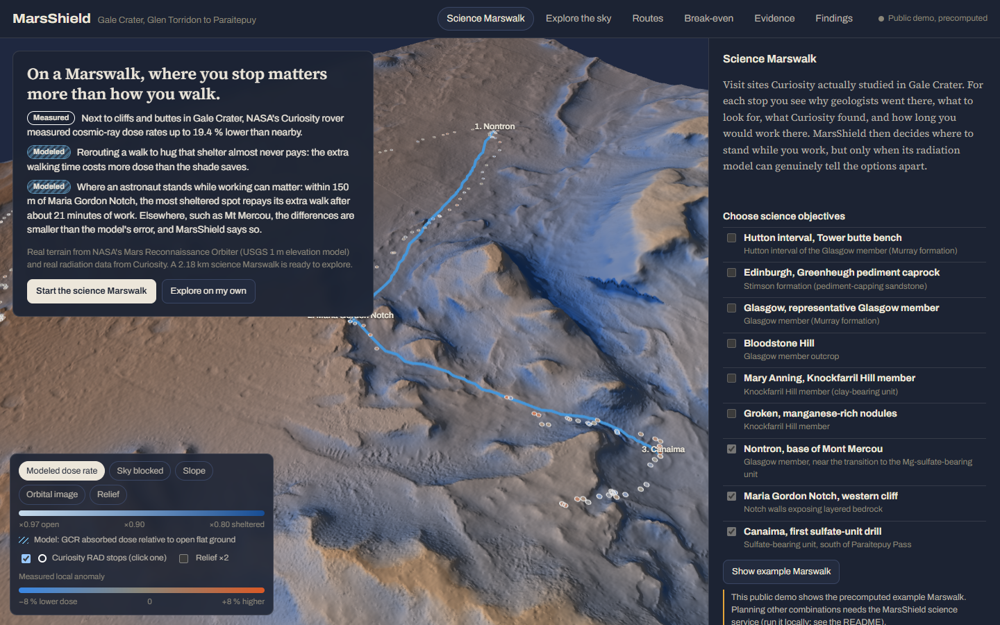
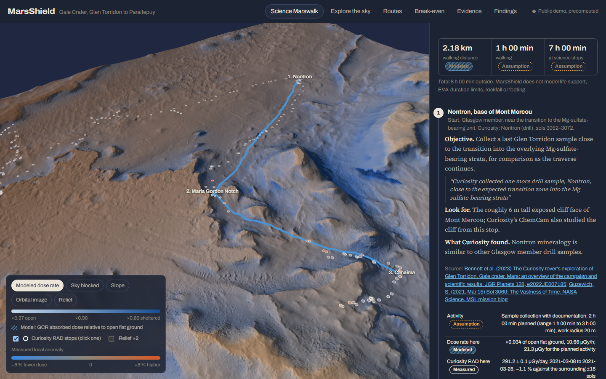
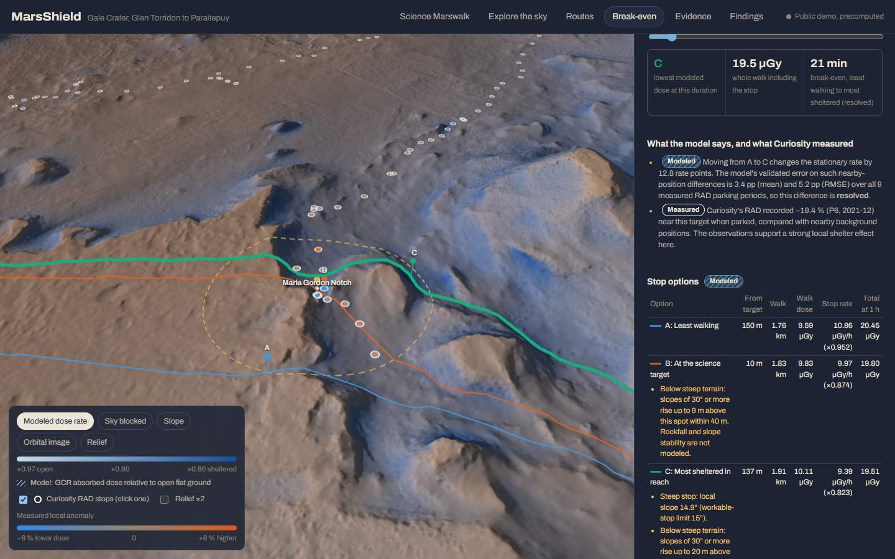
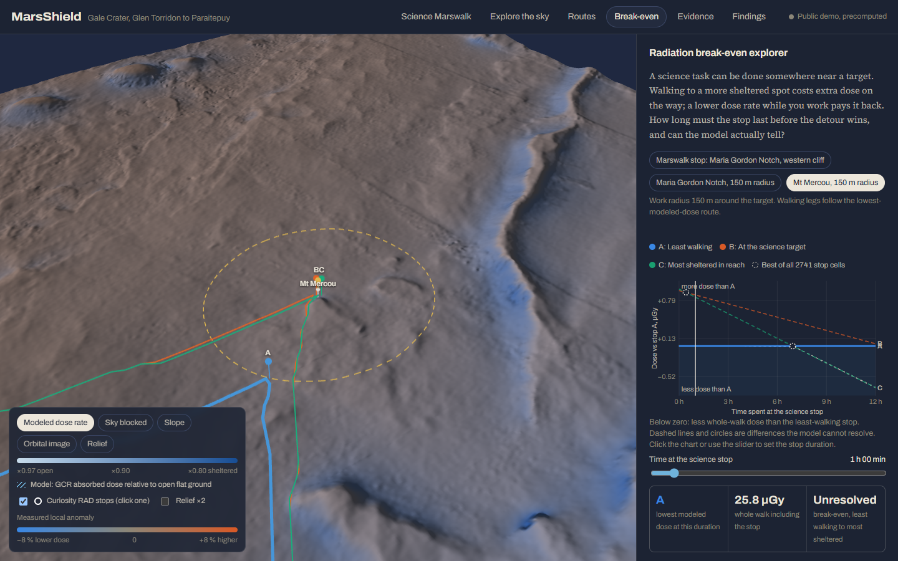
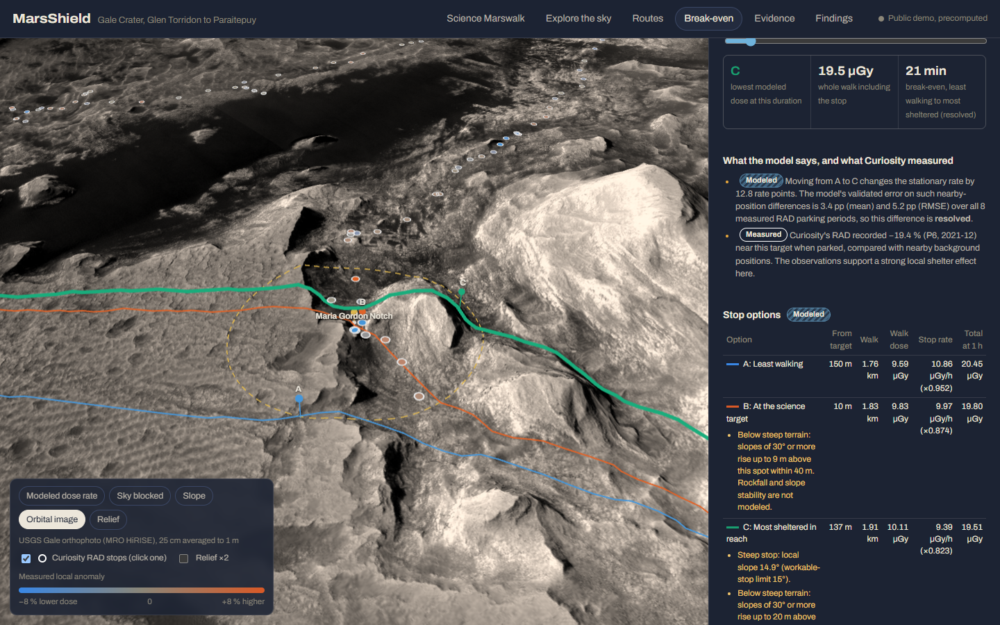
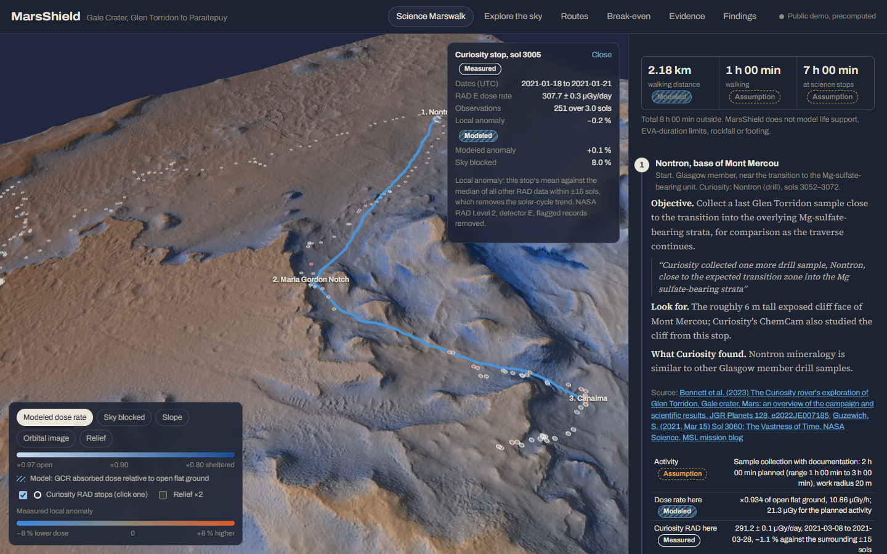

# MarsShield

**On a Marswalk, where you stop matters more than how you walk.**

MarsShield plans a science Marswalk through real Gale Crater terrain. It shows how the land around an astronaut blocks the sky and changes cosmic-ray exposure.
Built for the NASA Space Apps Challenge 2026, *Interplanetary Survival Guide: Martian Map*.

**Data it combines:**
- NASA's MSL Curiosity radiation measurements (RAD) and rover navigation
- terrain and imagery from MRO HiRISE and CTX
- MGS MOLA and Mars Express HRSC
- the published Curiosity science record

**Public demo (no backend needed):** https://snehal707.github.io/MarsShield/

## What you can do

| View | What it does | Live or precomputed |
|---|---|---|
| **Science Marswalk** | Nine documented Curiosity science targets (Hutton, Edinburgh, Glasgow, Bloodstone Hill, Mary Anning, Groken, Nontron, Maria Gordon Notch, Canaima). Each shows its objective, what to look for, what Curiosity found, the source, measured RAD at that spot and modeled dose. Choose objectives: MarsShield routes the walk and decides where to stand at each stop, but only when its model can resolve the difference. | Example Marswalk precomputed; other combinations need the science service |
| **Explore the sky** | Fisheye view of the sky above any point. It shows which directions the terrain blocks and how much cosmic-ray dose each direction carries. | Five sites precomputed; any point needs the science service |
| **Routes** | Five route strategies (shortest, fastest, lowest dose, maximum shielding, gentlest) compared on distance, slope, time and modeled dose, with uncertainty bands. | Example precomputed; new routes need the science service |
| **Break-even** | When does walking farther to a sheltered stop pay off? It reports break-even time, a resolvability status against validated model error, a model-error band, sensitivity to walking speed, radius and slope limit, and terrain flags. | Precomputed cases; custom targets need the science service |
| **Evidence** | Validation against NASA RAD data, the published study and the RAD team's horizon mask, plus the audit and sensitivity results. | Static |
| **Findings** | Scientific findings, which conclusions rest on observations, mission datasets, and limitations. | Static |

Map layers: modeled dose rate, sky blocked, slope, orbital image (USGS HiRISE orthophoto) and relief. Curiosity's RAD stops are clickable and show sol, dates, measured dose rate and local anomaly.
If WebGL is unavailable, the app shows the orbital image and all panels keep working.

## Screens

| | |
|---|---|
|  The opening finding, with measured and modeled claims labelled |  A documented Curiosity science stop: objective, quote, source, measured RAD, modeled dose, assumptions |
|  Maria Gordon Notch: a resolved break-even, with steep-stop and cliff flags |  Mt Mercou: differences below model error are marked unresolved |
|  USGS HiRISE orthophoto draped on the 1 m terrain |  Clicking a Curiosity stop shows the measured RAD observation |

## What is verified and what is modeled

| | Status |
|---|---|
| RAD dose rates, rover positions, terrain, orthophoto | **Observed NASA/USGS data**, used unaltered; dates and units preserved |
| Our reading of RAD L2 vs Guo et al. (2026) Table 1 | Median +0.24 %; 13 of 15 periods within +0.13 to +0.32 %, BG7 +0.9 %, P7 +3.7 % |
| Horizon ray tracing | Analytic shapes within 0.12°; Butte M12 vs RAD-team mask RMSE 0.91° |
| Sky blocking at the 15 published periods | Reproduced at 13; **not reproduced** at P6 and P8 (narrow canyons) |
| Dose model against all 8 measured drops | MAE 3.37 pp, RMSE 5.24 pp. **Not demonstrably better** than a proportional proxy (MAE 3.61, RMSE 5.20) |
| Break-even near Maria Gordon Notch | 0.36 h, **resolved** (0.25–0.60 h within model error); the stop is steep and below cliffs, and rockfall is not modeled |
| Break-even at Mt Mercou | **Unresolved**: below model error, so no recommendation |
| Audit of Guo et al. (2026) | 136 Table 1 cells, 0 transcription errors. The paper gives two P6 drops (19.4 % and 17 %); NASA data reproduce 19.4 % |
| Route doses, walking times, activity durations | **Modeled or assumed only**: quiet-time GCR absorbed dose in a plastic detector, Earth-derived walking speeds |

**Further documentation:**
- [docs/FINDINGS.md](docs/FINDINGS.md): findings and limitations for judges
- [docs/VALIDATION.md](docs/VALIDATION.md): every number, generated from the results
- [docs/METHODS.md](docs/METHODS.md): methods
- [docs/DATA_SOURCES.md](docs/DATA_SOURCES.md): provenance
- [docs/DEMO.md](docs/DEMO.md): a 3-minute demo script
- [docs/SUBMISSION.md](docs/SUBMISSION.md): submission text

## Run it

Requirements: Python 3.10+, Node 20+.

```powershell
# 1. Science pipeline: downloads about 400 MB of regional data, then computes (about 30-40 min the first time)
python -m venv .venv
.venv\Scripts\pip install -r science\requirements.txt
cd science
..\.venv\Scripts\python -m marsshield.pipeline        # ingest -> validation -> maps -> observations -> route eval -> audit -> web export
..\.venv\Scripts\python -m marsshield.report          # regenerate docs/VALIDATION.md
..\.venv\Scripts\python -m pytest tests -q

# 2. Live science service (custom Marswalks, routes, break-even, sky analysis)
..\.venv\Scripts\python -m uvicorn marsshield.api:app --port 8765

# 3. Web app, in a second terminal
cd web
npm ci
npm run build
npm start                                             # http://localhost:3000
```

**Public static build.** This is the same app as the public demo, with no backend:

```bash
cd web
STATIC_EXPORT=1 NEXT_PUBLIC_BASE_PATH=/MarsShield NEXT_PUBLIC_MARSSHIELD_API= npm run build   # writes web/out
```

GitHub Actions builds and deploys this on every push to `main` (`.github/workflows/pages.yml`). The test suite also runs on a clean machine (`tests.yml`); tests that need the full terrain data skip themselves there.

## Repository layout

```
science/marsshield/   ingest, horizon, radiation, routing, planner, terrain, observations, validation, route_eval,
                      breakeven, targets, mission, audit, report, pipeline, api, published (reference values)
science/tests/        pytest suite
data/processed/       validation, observations, route evaluation, audit and mission results (JSON)
web/                  Next.js + React + Three.js app; web/public/data = exported, precomputed assets
docs/                 FINDINGS, METHODS, DATA_SOURCES, VALIDATION, DEMO, SUBMISSION
```

Downloaded source data (`data/raw/`) and the 53 MB routing grid are not committed; the pipeline recreates them.
