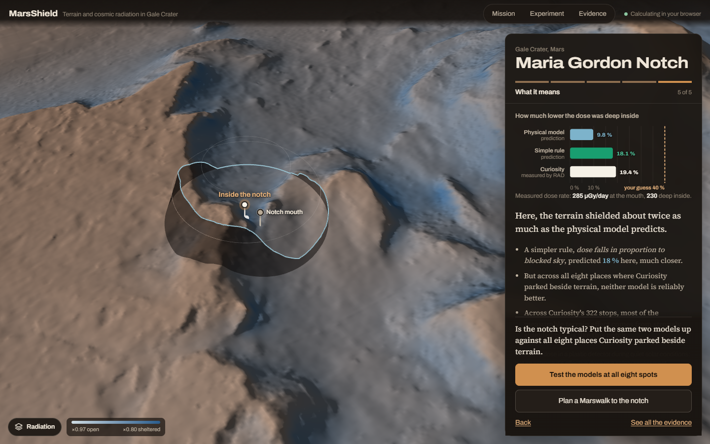
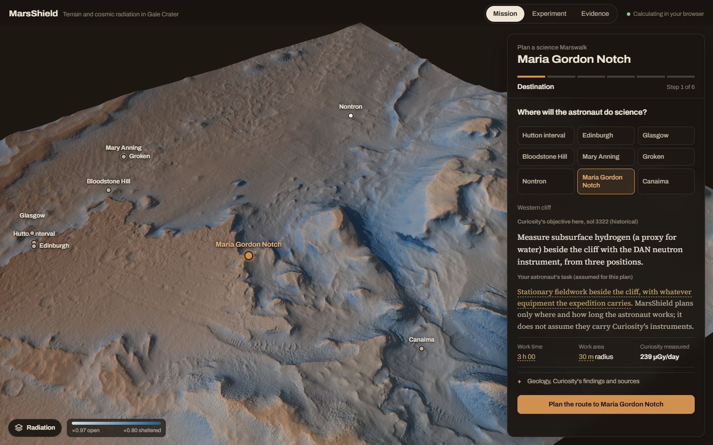
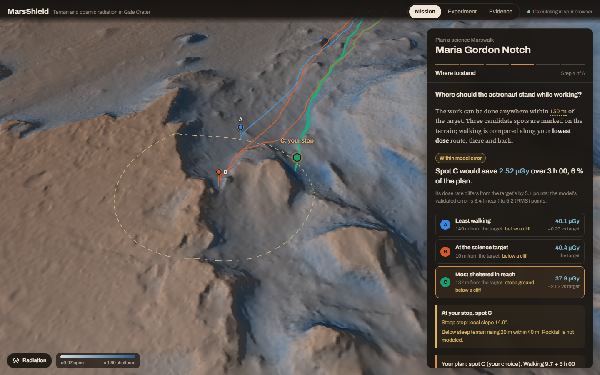
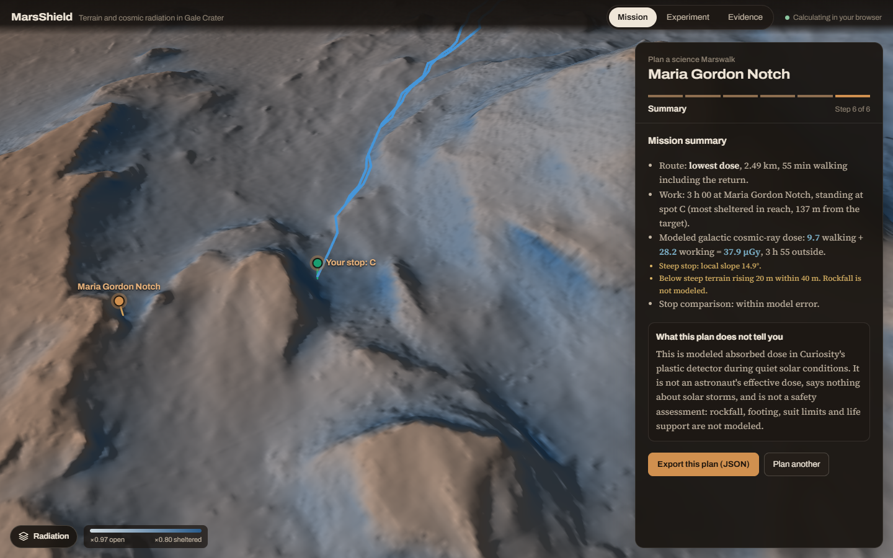
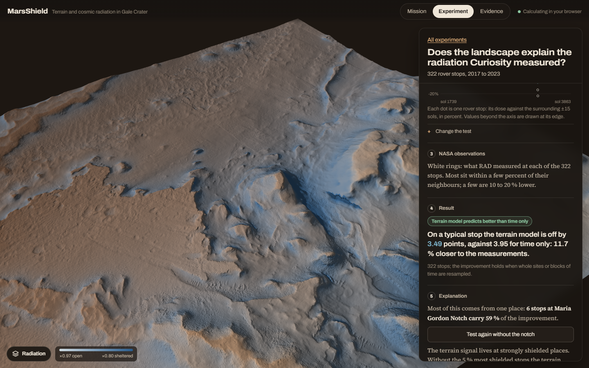
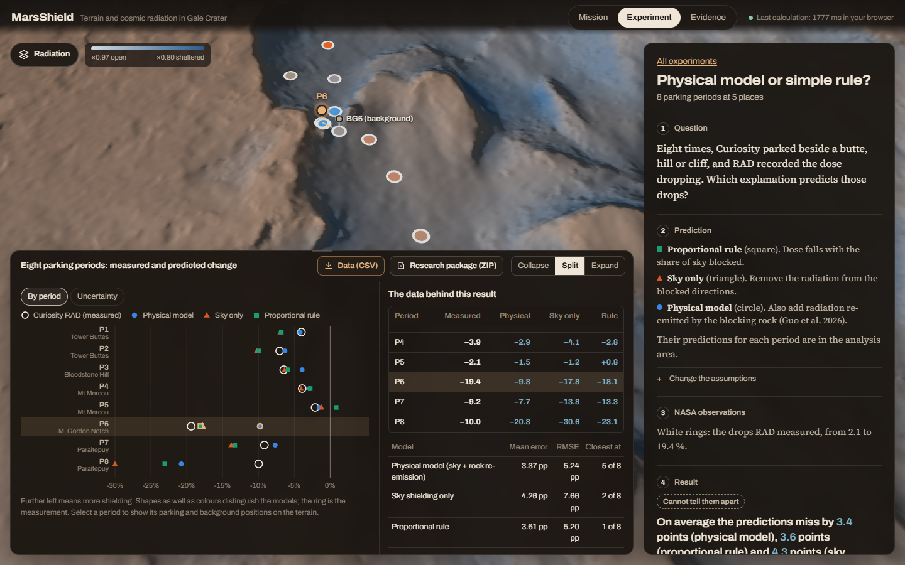

# MarsShield

**On a Marswalk, where you stop matters more than how you walk.**

MarsShield plans a science Marswalk through real Gale Crater terrain. It shows how the land around an astronaut blocks the sky and changes cosmic-ray exposure.
Built for the NASA Space Apps Challenge 2026, *Interplanetary Survival Guide: Martian Map*.

**Data it combines:**
- NASA's MSL Curiosity radiation measurements (RAD), surface pressure (REMS) and rover navigation
- terrain and imagery from MRO HiRISE and CTX
- MGS MOLA and Mars Express HRSC
- the published Curiosity science record

**Public demo (no backend needed):** https://marsshield.vercel.app (Vercel, fastest) and https://snehal707.github.io/MarsShield/ (GitHub Pages mirror)

## The opening: Maria Gordon Notch

The site opens with a five-step guided story on the real terrain:
1. **The place.** In December 2021 Curiosity parked twice, 16 m apart: deep inside the notch, then at its mouth.
2. **The question.** How much lower is the dose deep inside? Visitors can guess first.
3. **The model.** The published physical model, run on MarsShield's reconstruction of the notch, predicts 9.8 % lower (13.3 % with the published geometry; the reconstruction is uncertain in a 16 m-wide notch).
4. **The measurement.** NASA's RAD measured 19.4 % lower (285 → 230 µGy/day).
5. **What it means.** A simple blocked-sky rule (18 %) came closer here, but across all eight measured spots neither model is reliably better.

The comparison is drawn as bars of the drop itself, so the gap between prediction and measurement is visible at a glance. Every number is read from the exported RAD reduction and audit files. Clicking the wordmark replays the story. Corrections and their earlier values are listed in [docs/SCIENCE_AUDIT.md](docs/SCIENCE_AUDIT.md); the research layout and accessibility changes in [docs/RESEARCH_WORKSPACE.md](docs/RESEARCH_WORKSPACE.md).

## Three regions: Gale, Jezero and Olympus Mons

MarsShield opens on a **Mars overview**: why cosmic rays reach the Martian surface, the three research regions, and a comparison under one set of assumptions. The assumptions are quantity, solar modulation, season and mission duration, and they apply to every region.

**Comparison method:**
- **Transport model:** published AtRIS/Geant4 surface tables (Zhang et al. 2022, doi:10.1029/2021JE007157; data doi:10.5281/zenodo.5953666).
- **Atmosphere:** Mars Climate Database v6.2 pressure at each site, checked against Perseverance MEDA at Jezero (0.5 % difference).
- **Quantities:** effective dose, dose equivalent and water-phantom absorbed dose. These are not RAD-E dose, and are never converted into each other.

**Findings:**
- **Olympus Mons:** effective dose about 4 % lower than Gale at 700 MV, growing to 7 % at 1000 MV and vanishing at solar minimum; dose equivalent about 5.5 % lower at 580 MV.
- **Jezero:** not distinguishable from Gale within the model's 1 % Monte Carlo noise.
- **Pressure dependence:** the model's pressure dependence is about 50× weaker than RAD observes at Gale. The regional estimates are therefore exploratory, and nothing about them is validated outside Gale.

**Regional workspaces:**
- Jezero and the Olympus Mons caldera each have Radiation, Terrain, and Sources and limits tabs.
- The radiation tab gives the atmosphere overhead and a click-to-evaluate location dose.
- The terrain tab gives 3D terrain, slope, profiles, the Perseverance traverse and the USGS caldera geologic map.
- The comparison chart and table, with CSV and research-package downloads, sit in the analysis dock.

**Case study:** the Maria Gordon Notch story is an optional Gale case study, opened from the Gale card or the Gale top bar.

Details: [docs/REGIONAL_RADIATION.md](docs/REGIONAL_RADIATION.md) (methods, equations, validation, uncertainty, blockers) and [docs/REGIONS.md](docs/REGIONS.md) (terrain data).

## Three ways in

| Mode | Question it answers | What you can change in the browser |
|---|---|---|
| **Mission** | Plan a science Marswalk to one of nine documented Curiosity targets and back: is it worth walking farther to a more sheltered spot, and can the model tell? | Destination, start, return trip, walking speed, work duration, EVA time cap, work radius. Routes (4 strategies) and the break-even trade-off are recomputed live. |
| **Experiment** | Test the radiation models against Curiosity's measurements: predict first, then reveal. Three experiments: terrain vs time at 322 stops; physical model vs blocked-sky rule at the 8 parking periods; the stops where the models disagree most. | Model, baseline, stop subset, number of time blocks, bootstrap block length, albedo α, the paper's alternative P6 drop, number of disagreement stops. Verdicts and intervals are recomputed live. Charts, the data table and the CSV and research-package downloads sit in a resizable analysis dock linked to the terrain ([docs/RESEARCH_WORKSPACE.md](docs/RESEARCH_WORKSPACE.md)). |
| **Evidence** | What was measured, what was modeled, and how well they agree, including the RAD + REMS pressure analysis, validation, limitations and provenance. | Read-only. |

The terrain is the main view, with a single **Layers** control: modeled dose rate, orbital image (USGS HiRISE orthophoto), relief, model disagreement, sky blocked and slope. Curiosity's 322 RAD stops are hidden by default and can be switched on there. Every experiment follows the same sequence: question, prediction, reveal NASA's observations, result, explanation. Uncertainty and statistics are one click away rather than in the way.

Colors keep sources apart throughout: measured values are white, model values blue, and planning assumptions underlined in dashed gold. If WebGL is unavailable, the app shows the orbital image and every panel keeps working.

**Research downloads.** Every experiment has two download buttons, both generated in the browser with no server:
- **Data (CSV):** the exact rows in your current selection (subset, model, baseline and validation settings), with observations and predictions joined.
- **Research package (ZIP):**
  - `observations.csv` and `predictions.csv`
  - `experiment.json`: selections, model formulas, fitted coefficients per validation block, random seeds, results and limitations
  - `datapackage.json`: a Frictionless Data Package schema giving every column's unit, type, definition and category (observed, derived or modeled)
  - `README.md`: provenance, Mars coordinate reference, and a Python recipe that rebuilds the held-out predictions from `observations.csv`

Packages identify the processed dataset by its SHA-256 and link to NASA's original archives. Processed values are not presented as raw measurements. Coordinates are Mars 2000 sphere equirectangular metres, plus Mars planetocentric degrees, labelled as Mars, not Earth.

**What runs where.**
- **In the browser:** routing (Dijkstra on the 5 m grid), the break-even search, cross-validation, bootstrap intervals and parking-period predictions. These are TypeScript ports checked against the Python outputs (`web/scripts/verify-*.mts`).
- **Python only, precomputed:** horizon ray tracing, the RAD and REMS reductions, the dose-model fits, the sky fisheyes and the large site bootstraps. The API (`marsshield.api`) adds sky analysis at arbitrary points.

Audiences and the question each can answer: [docs/AUDIENCES.md](docs/AUDIENCES.md). No external user testing has been done.

## Screens

| | |
|---|---|
|  The opening story: model prediction vs Curiosity's measurement at Maria Gordon Notch |  Mission: compact destination choice, objective first |
|  Where to stand: decision and dose difference first; the selected spot's own hazard flags |  The plan's route, stop and totals, all from one computation |
|  Experiment: question, prediction, reveal, result, explanation |  Physical model or simple rule: cannot tell them apart |

Story opening: [docs/img/1-notch-story-start.png](docs/img/1-notch-story-start.png). Mission evidence, three references: [docs/img/4-mission-evidence.png](docs/img/4-mission-evidence.png). Phone: [story](docs/img/7-phone-story.png), [where to stand](docs/img/8-phone-where-to-stand.png). No-WebGL fallback: [docs/img/9-no-webgl.png](docs/img/9-no-webgl.png). Earlier interfaces are in `docs/img/before/` (`v2-*` is the version before the current redesign).

## What is verified and what is modeled

| | Status |
|---|---|
| RAD dose rates, rover positions, terrain, orthophoto | **Observed NASA/USGS data**, used unaltered; dates and units preserved |
| Our reading of RAD L2 vs Guo et al. (2026) Table 1 | Median +0.24 %; 13 of 15 periods within +0.13 to +0.32 %, BG7 +0.9 %, P7 +3.7 % |
| Horizon ray tracing | Analytic shapes within 0.12°; Butte M12 vs RAD-team mask RMSE 0.91° |
| Sky blocking at the 15 published periods | Reproduced at 13; **not reproduced** at P6 and P8 (narrow canyons) |
| Dose model against all 8 measured drops | MAE 3.37 pp, RMSE 5.24 pp. **Not demonstrably better** than a proportional proxy (MAE 3.61, RMSE 5.20) |
| Break-even near Maria Gordon Notch | 0.36 h, **resolved** (0.25–0.60 h within model error); the stop is steep and below cliffs, and rockfall is not modeled |
| Break-even at Mt Mercou | **Unresolved**: below model error, so no recommendation |
| Audit of Guo et al. (2026) | 136 Table 1 cells, 0 transcription errors. The paper gives two P6 drops (19.4 % and 17 %); NASA data reproduce 19.4 % |
| Terrain beyond pressure and time, 322 rover stops (RAD + REMS) | Reconstructs *local* dose anomalies along Curiosity's past traverse (not absolute dose at new places). Held-out **RMSE −11.7 %** vs time only (MSE −22 %; site-resampled interval excludes zero). **59 % of the gain comes from 6 stops at Maria Gordon Notch**, a site also used to calibrate the model's albedo parameter, so this is only partly independent. Without the notch the RMSE change is −5.5 % (interval still excludes zero); without the 10 % most shielded stops it is not distinguishable from zero. **Pressure: no measurable gain** at stop level. **Terrain model vs blocked-sky rule: cannot distinguish** |
| Route doses, walking times, activity durations | **Modeled or assumed only**: quiet-time GCR absorbed dose in a plastic detector, Earth-derived walking speeds |

**Further documentation:**
- [docs/FINDINGS.md](docs/FINDINGS.md): findings and limitations for judges
- [docs/VALIDATION.md](docs/VALIDATION.md): every number, generated from the results
- [docs/METHODS.md](docs/METHODS.md): methods
- [docs/DATA_SOURCES.md](docs/DATA_SOURCES.md): provenance
- [docs/DEMO.md](docs/DEMO.md): a 3-minute demo script
- [docs/USABILITY_TEST.md](docs/USABILITY_TEST.md): usability test script (not yet run with participants)
- [docs/AUDIENCES.md](docs/AUDIENCES.md): intended audiences and their questions
- [docs/SUBMISSION.md](docs/SUBMISSION.md): submission text

## Run it

Requirements: Python 3.10+, Node 20+.

```powershell
# 1. Science pipeline: downloads about 400 MB of regional data, then computes (about 30-40 min the first time)
python -m venv .venv
.venv\Scripts\pip install -r science\requirements.txt
cd science
..\.venv\Scripts\python -m marsshield.pipeline        # ingest -> validation -> maps -> observations -> REMS + terrain signal -> route eval -> audit -> web export
..\.venv\Scripts\python -m marsshield.report          # regenerate docs/VALIDATION.md
..\.venv\Scripts\python -m pytest tests -q

# 2. Live science service (custom Marswalks, routes, break-even, sky analysis)
..\.venv\Scripts\python -m uvicorn marsshield.api:app --port 8765

# 3. Web app, in a second terminal
cd web
npm ci
npm run build
npm start                                             # http://localhost:3000
node scripts/verify-engine.mts                        # browser engine vs Python outputs (Node >= 22.18)
node scripts/verify-stats.mts
```

**Public static build.** This is the same app as the public demo, with no backend:

```bash
cd web
STATIC_EXPORT=1 NEXT_PUBLIC_BASE_PATH=/MarsShield NEXT_PUBLIC_MARSSHIELD_API= npm run build   # writes web/out
```

GitHub Actions builds and deploys this on every push to `main` (`.github/workflows/pages.yml`). The test suite also runs on a clean machine (`tests.yml`); tests that need the full terrain data skip themselves there. The same workflow typechecks, lints and verifies the browser engine.

## Repository layout

```
science/marsshield/   ingest, horizon, radiation, routing, planner, terrain, observations, rems, terrain_signal, validation,
                      route_eval, breakeven, targets, mission, audit, report, pipeline, api, published (reference values)
science/tests/        pytest suite
data/processed/       validation, observations, route evaluation, audit and mission results (JSON)
web/                  Next.js + React + Three.js app; src/lib/engine.ts + stats.ts = browser engine;
                      web/public/data = exported, precomputed assets
docs/                 FINDINGS, METHODS, DATA_SOURCES, VALIDATION, AUDIENCES, DEMO, SUBMISSION
```

Downloaded source data (`data/raw/`) and the 53 MB routing grid are not committed; the pipeline recreates them.
