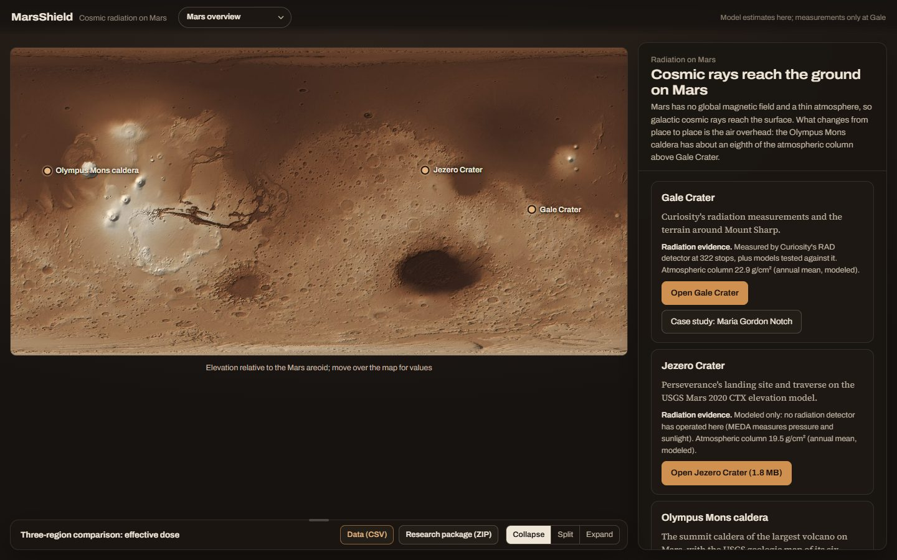
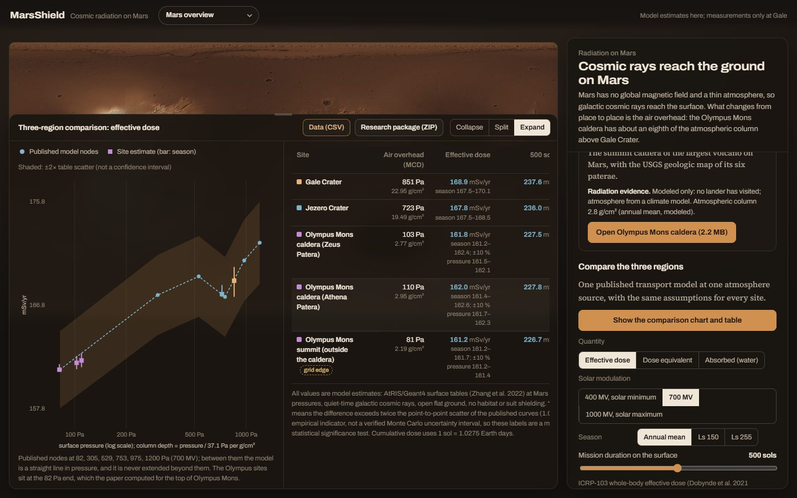
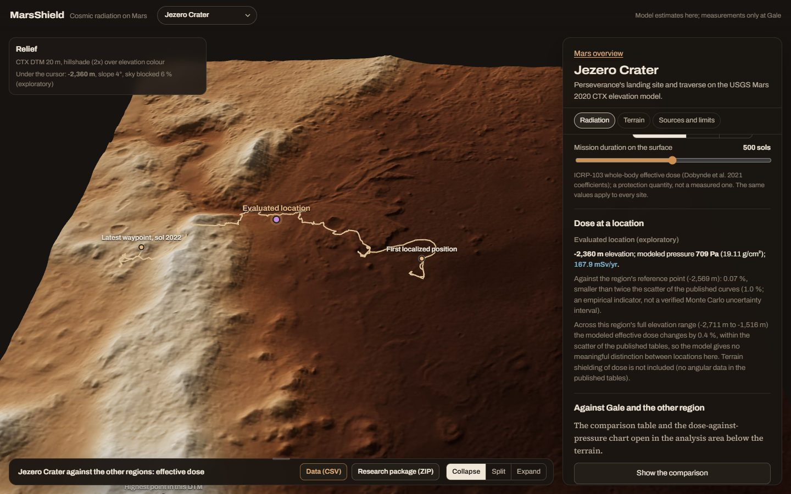
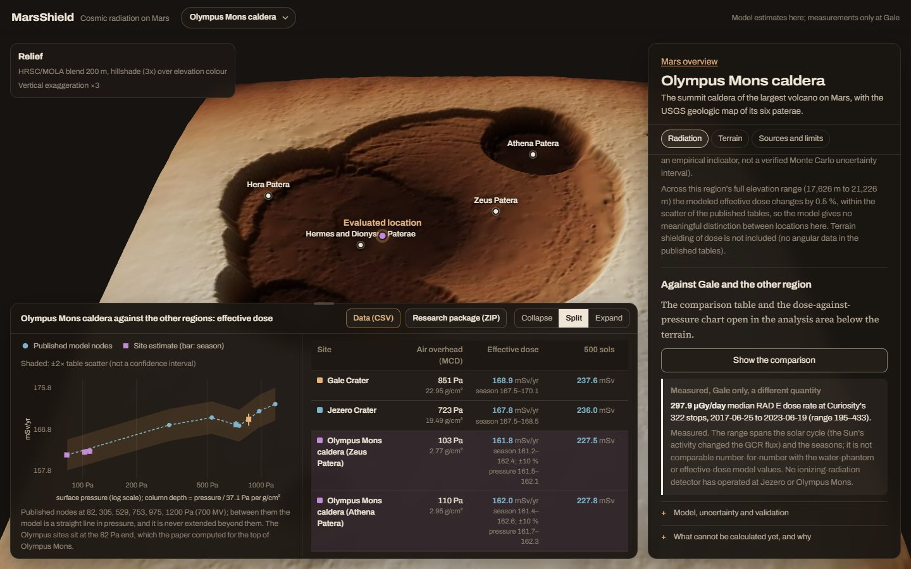
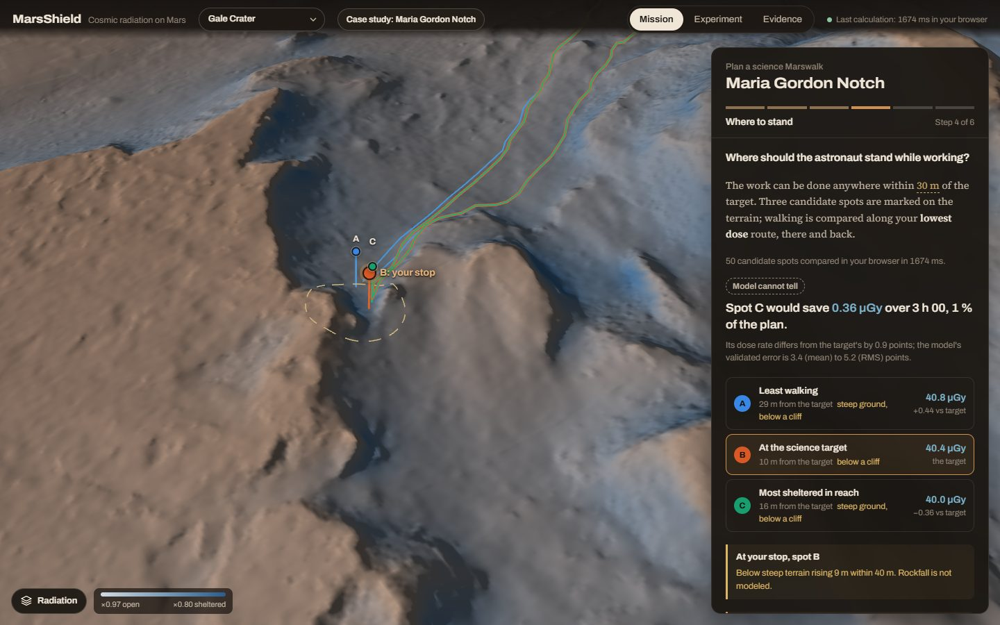
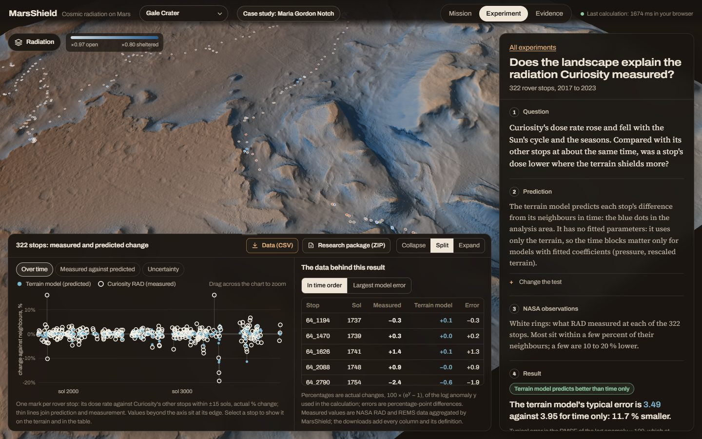
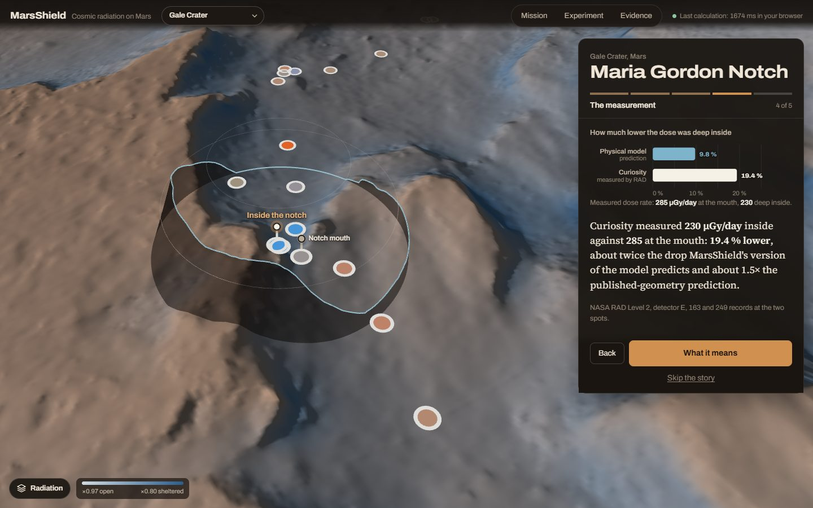
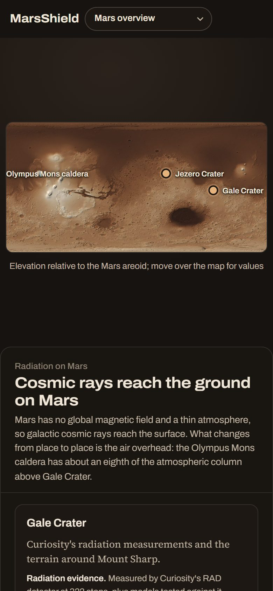

# MarsShield

**Cosmic radiation on the surface of Mars, region by region: measured at Gale Crater, estimated at Jezero Crater and on Olympus Mons.**

MarsShield is a research platform for the radiation environment of three Martian regions, built on real NASA, ESA and USGS data. It opens on a Mars overview that explains why galactic cosmic rays reach the ground on Mars and compares the three regions under one set of assumptions. Each region then opens its own workspace.

Built for the NASA Space Apps Challenge 2026, *Interplanetary Survival Guide: Martian Map*.

- **Live application:** https://marsshield.vercel.app (primary)
- **Mirror:** https://snehal707.github.io/MarsShield/ (GitHub Pages; slower to load)
- **Code:** https://github.com/Snehal707/MarsShield
- **Demo video (29 s):** https://youtu.be/pvGjpGUpz6I

[](https://youtu.be/pvGjpGUpz6I)

## Three regions, three kinds of evidence

| Region | Radiation evidence | What you can do |
|---|---|---|
| **Gale Crater** | **Measured.** Curiosity's RAD detector at 322 rover stops and 8 parking periods, with REMS surface pressure. A terrain-shielding dose model is tested against these measurements. | Plan a science Marswalk (Mission). Test models against RAD by predicting and then revealing the measurements (Experiment). Read the evidence, validation and audit (Evidence). The optional **Maria Gordon Notch case study** is here. |
| **Jezero Crater** | **Modeled only.** No ionizing-radiation detector has operated there; Perseverance's MEDA measures pressure and sunlight. | GCR dose estimates at Mars Climate Database pressure (checked against MEDA). Click-to-evaluate dose at a location, mission-duration dose, 3D terrain from the USGS CTX DTM, and Perseverance's 708-waypoint traverse. |
| **Olympus Mons caldera** | **Modeled only.** No lander has visited; the atmosphere comes from a climate model. | GCR dose estimates at about one eighth of Gale's atmospheric column. Caldera terrain from the HRSC/MOLA blend, the USGS SIM 3470 geologic map, and elevation profiles. |

Measured values are white, model values blue, and planning assumptions underlined in dashed gold, throughout the app.

## Three-region radiation comparison

All three regions, Gale included, are computed the same way. The assumptions are set once and apply to every region: quantity, solar modulation, season and mission duration.

**Method:**
- **Transport model:** published AtRIS/Geant4 surface dose tables (Zhang et al. 2022, JGR Planets, doi:10.1029/2021JE007157; data doi:10.5281/zenodo.5953666).
- **Atmosphere:** Mars Climate Database v6.2 pressure at each site. At Jezero it agrees with Perseverance MEDA to 0.5 %.
- **Quantities:** effective dose, dose equivalent and water-phantom absorbed dose. These are not Curiosity RAD-E dose, and they are never converted into each other.
- **Interpolation:** linear in pressure between the published nodes, never extrapolated.

**Findings:**
- **Olympus Mons:** effective dose about 4 % lower than Gale at 700 MV, growing to about 7 % at 1000 MV and vanishing at solar minimum (400 MV). Dose equivalent is about 5.5 % lower at 580 MV.
- **Jezero:** within the roughly 1 % point-to-point scatter of the published tables, so the model gives no meaningful difference from Gale. That scatter is an empirical indicator, not a verified uncertainty interval, and the "beyond/within table scatter" labels are a model comparison, not a significance test.
- **Within a region:** the modeled dose changes by under 0.5 % across each region's relief, so the model does not distinguish locations there.
- **Pressure response (a limitation):** the model's water-sphere dose responds to pressure about 50× less than Curiosity's RAD plastic detector does over the day. The detector materials and observing conditions differ, so this is not a like-for-like validation test, but it leaves the small regional differences uncertain.
- **Validation:** nothing is validated outside Gale. Agreement at Gale does not make the Jezero or Olympus Mons values accurate predictions, and none of them is an astronaut risk or safety assessment.

**Workspaces:**
- **Jezero and Olympus Mons:** Radiation, Terrain, and Sources and limits tabs.
- **Analysis dock:** the dose-against-pressure chart and the comparison table, with CSV and research-package downloads. It starts collapsed so the map stays visible, and opens on request.

**Not calculated, with the evidence each would need:**
- RAD-E dose outside Gale
- absorbed dose at solar modulation other than 580 MV
- terrain shielding of dose outside Gale
- an independent transport rerun
- regional solar particle events

Details: [docs/REGIONAL_RADIATION.md](docs/REGIONAL_RADIATION.md) (methods, equations, validation, uncertainty, blockers) and [docs/REGIONS.md](docs/REGIONS.md) (regional terrain data).

## Gale Crater: measurements, experiments and Marswalk planning


| Mode | Question it answers | What you can change in the browser |
|---|---|---|
| **Mission** | Plan a science Marswalk to one of nine documented Curiosity targets and back: is it worth walking farther to a more sheltered spot, and can the model tell? | Destination, start, return trip, walking speed, work duration, EVA time cap, work radius. Routes (4 strategies) and the break-even trade-off are recomputed live. |
| **Experiment** | Test the radiation models against Curiosity's measurements: predict first, then reveal. Three experiments: terrain vs time at 322 stops; physical model vs blocked-sky rule at the 8 parking periods; the stops where the models disagree most. | Model, baseline, stop subset, number of time blocks, bootstrap block length, albedo α, the paper's alternative P6 drop, number of disagreement stops. Verdicts and intervals are recomputed live. Charts, the data table and the CSV and research-package downloads sit in a resizable analysis dock linked to the terrain ([docs/RESEARCH_WORKSPACE.md](docs/RESEARCH_WORKSPACE.md)). |
| **Evidence** | What was measured, what was modeled, and how well they agree, including the RAD + REMS pressure analysis, validation, limitations and provenance. | Read-only. |

The terrain is the main view, with a single **Layers** control: modeled dose rate, orbital image (USGS HiRISE orthophoto), relief, model disagreement, sky blocked and slope. Curiosity's 322 RAD stops are hidden by default and can be switched on there. Every experiment follows the same sequence: question, prediction, reveal NASA's observations, result, explanation. Uncertainty and statistics are one click away rather than in the way.

Colors keep sources apart throughout: measured values are white, model values blue, and planning assumptions underlined in dashed gold. If WebGL is unavailable, the app shows the orbital image and every panel keeps working.

**Research downloads.** Every experiment has two download buttons, both generated in the browser with no server:
- **Data (CSV):** the exact rows in your current selection (subset, model, baseline and validation settings), with observations and predictions joined.
- **Research package (ZIP):**
  - `observations.csv` and `predictions.csv`
  - `experiment.json`: selections, model formulas, fitted coefficients per validation block, random seeds, results and limitations
  - `datapackage.json`: a Frictionless Data Package schema giving every column's unit, type, definition and category (observed, derived or modeled)
  - `README.md`: provenance, Mars coordinate reference, and a Python recipe that rebuilds the held-out predictions from `observations.csv`

Packages identify the processed dataset by its SHA-256 and link to NASA's original archives. Processed values are not presented as raw measurements. Coordinates are Mars 2000 sphere equirectangular metres, plus Mars planetocentric degrees, labelled as Mars, not Earth.

**What runs where.**
- **In the browser:** routing (Dijkstra on the 5 m grid), the break-even search, cross-validation, bootstrap intervals and parking-period predictions. These are TypeScript ports checked against the Python outputs (`web/scripts/verify-*.mts`).
- **Python only, precomputed:** horizon ray tracing, the RAD and REMS reductions, the dose-model fits, the sky fisheyes and the large site bootstraps. The API (`marsshield.api`) adds sky analysis at arbitrary points.

Audiences and the question each can answer: [docs/AUDIENCES.md](docs/AUDIENCES.md). No external user testing has been done.

## Maria Gordon Notch case study (optional, in Gale)

Open it from the Gale card in the overview or from the button in Gale's top bar. It is a five-step guided story on the real terrain:
1. **The place.** In December 2021 Curiosity parked twice, 16 m apart: deep inside the notch, then at its mouth.
2. **The question.** How much lower is the dose deep inside? Visitors can guess first.
3. **The model.** The published physical model, run on MarsShield's reconstruction of the notch, predicts 9.8 % lower (13.3 % with the published geometry; the reconstruction is uncertain in a 16 m-wide notch).
4. **The measurement.** NASA's RAD measured 19.4 % lower (285 → 230 µGy/day).
5. **What it means.** A simple blocked-sky rule (18 %) came closer here, but across all eight measured spots neither model is reliably better.

Corrections and their earlier values are listed in [docs/SCIENCE_AUDIT.md](docs/SCIENCE_AUDIT.md).

## Screens

Captured from the live deployment at https://marsshield.vercel.app (`docs/img/current/`).

| | |
|---|---|
|  Mars overview: radiation framing and the three regions |  Three-region comparison: dose against pressure and the comparison table |
|  Jezero: Radiation tab with an evaluated location on the traverse |  Olympus Mons caldera: Radiation tab and comparison |
|  Gale Mission: where to stand, judged against model error |  Gale Experiment: model predictions revealed against Curiosity RAD |
|  Optional Gale case study: Maria Gordon Notch |  Phone: Mars overview ([Jezero on a phone](docs/img/current/9-phone-jezero.jpg)) |

**Earlier screenshots, still accurate for Gale:**
- Mission: [destination](docs/img/2-mission-destination.png), [where to stand](docs/img/3-where-to-stand.png), [evidence](docs/img/4-mission-evidence.png), [summary](docs/img/4-mission-summary.png)
- Experiment: [parking](docs/img/6-experiment-parking.png), [result](docs/img/5-experiment-result.png)
- Phone: [story](docs/img/7-phone-story.png), [where to stand](docs/img/8-phone-where-to-stand.png)
- [No-WebGL fallback](docs/img/9-no-webgl.png)

Development phases are in `docs/img/phase2/` and `docs/img/phase3/`. Earlier interfaces are in `docs/img/before/`.

## What is verified and what is modeled

| | Status |
|---|---|
| RAD dose rates, rover positions, terrain, orthophoto | **Observed NASA/USGS data**, used unaltered; dates and units preserved |
| Our reading of RAD L2 vs Guo et al. (2026) Table 1 | Median +0.24 %; 13 of 15 periods within +0.13 to +0.32 %, BG7 +0.9 %, P7 +3.7 % |
| Horizon ray tracing | Analytic shapes within 0.12°; Butte M12 vs RAD-team mask RMSE 0.91° |
| Sky blocking at the 15 published periods | Reproduced at 13; **not reproduced** at P6 and P8 (narrow canyons) |
| Dose model against all 8 measured drops | MAE 3.37 pp, RMSE 5.24 pp. **Not demonstrably better** than a proportional proxy (MAE 3.61, RMSE 5.20) |
| Break-even near Maria Gordon Notch | 0.36 h, **resolved** (0.25–0.60 h within model error); the stop is steep and below cliffs, and rockfall is not modeled |
| Break-even at Mt Mercou | **Unresolved**: below model error, so no recommendation |
| Audit of Guo et al. (2026) | 136 Table 1 cells, 0 transcription errors. The paper gives two P6 drops (19.4 % and 17 %); NASA data reproduce 19.4 % |
| Terrain beyond pressure and time, 322 rover stops (RAD + REMS) | Reconstructs *local* dose anomalies along Curiosity's past traverse (not absolute dose at new places). Held-out **RMSE −11.7 %** vs time only (MSE −22 %; site-resampled interval excludes zero). **59 % of the gain comes from 6 stops at Maria Gordon Notch**, a site also used to calibrate the model's albedo parameter, so this is only partly independent. Without the notch the RMSE change is −5.5 % (interval still excludes zero); without the 10 % most shielded stops it is not distinguishable from zero. **Pressure: no measurable gain** at stop level. **Terrain model vs blocked-sky rule: cannot distinguish** |
| Route doses, walking times, activity durations | **Modeled or assumed only**: quiet-time GCR absorbed dose in a plastic detector, Earth-derived walking speeds |

**Further documentation:**
- [docs/SUBMISSION.md](docs/SUBMISSION.md): submission text, data sources, limitations and AI-use disclosure
- [docs/DEMO_30S.md](docs/DEMO_30S.md): a 30-second demonstration script
- [docs/REGIONAL_RADIATION.md](docs/REGIONAL_RADIATION.md): three-region radiation model, validation and blockers
- [docs/REGIONS.md](docs/REGIONS.md): regional terrain data and manifests
- [docs/FINDINGS.md](docs/FINDINGS.md): findings and limitations for judges
- [docs/VALIDATION.md](docs/VALIDATION.md): every number, generated from the results
- [docs/METHODS.md](docs/METHODS.md): methods
- [docs/DATA_SOURCES.md](docs/DATA_SOURCES.md): provenance
- [docs/DEMO.md](docs/DEMO.md): a 3-minute walkthrough
- [docs/USABILITY_TEST.md](docs/USABILITY_TEST.md): usability test script (not yet run with participants)
- [docs/AUDIENCES.md](docs/AUDIENCES.md): intended audiences and their questions
- [docs/SCIENCE_AUDIT.md](docs/SCIENCE_AUDIT.md), [docs/SPE_FEASIBILITY.md](docs/SPE_FEASIBILITY.md), [docs/RESEARCH_WORKSPACE.md](docs/RESEARCH_WORKSPACE.md), [docs/FINAL_REPORT.md](docs/FINAL_REPORT.md): audit, solar events, workspace and phase report

## Run it

Requirements: Python 3.10+, Node 20+.

```powershell
# 1. Science pipeline: downloads about 400 MB of regional data, then computes (about 30-40 min the first time)
python -m venv .venv
.venv\Scripts\pip install -r science\requirements.txt
cd science
..\.venv\Scripts\python -m marsshield.pipeline        # ingest -> validation -> maps -> observations -> REMS + terrain signal -> route eval -> audit -> web export
..\.venv\Scripts\python -m marsshield.report          # regenerate docs/VALIDATION.md
..\.venv\Scripts\python -m marsshield.regions         # Mars overview, Jezero and Olympus Mons terrain (about 12 MB plus range reads)
..\.venv\Scripts\python -m marsshield.atmosphere ..\data\raw\atmosphere\meda_ps_sampled_every20sols.json   # site pressures (add --query to re-query MCD)
..\.venv\Scripts\python -m marsshield.regional_dose   # three-region dose comparison (Zenodo 5953666)
..\.venv\Scripts\python -m pytest tests -q

# 2. Live science service (custom Marswalks, routes, break-even, sky analysis)
..\.venv\Scripts\python -m uvicorn marsshield.api:app --port 8765

# 3. Web app, in a second terminal
cd web
npm ci
npm run build
npm start                                             # http://localhost:3000
node scripts/verify-engine.mts                        # browser engine vs Python outputs (Node >= 22.18)
node scripts/verify-stats.mts
node scripts/verify-radiation.mts                     # three-region dose: browser vs Python
```

**Public static build.** This is the same app as the public demo, with no backend:

```bash
cd web
STATIC_EXPORT=1 NEXT_PUBLIC_BASE_PATH=/MarsShield NEXT_PUBLIC_MARSSHIELD_API= npm run build   # writes web/out
```

GitHub Actions builds and deploys this on every push to `main` (`.github/workflows/pages.yml`). The test suite also runs on a clean machine (`tests.yml`); tests that need the full terrain data skip themselves there. The same workflow typechecks, lints and verifies the browser engine.

## Repository layout

```
science/marsshield/   ingest, horizon, radiation, routing, planner, terrain, observations, rems, terrain_signal, validation,
                      route_eval, breakeven, targets, mission, audit, report, pipeline, api, published (reference values),
                      sep_events, parking_audit, regions, atmosphere, regional_dose
science/tests/        pytest suite
data/processed/       validation, observations, route evaluation, audit and mission results (JSON)
web/                  Next.js + React + Three.js app; src/lib/engine.ts + stats.ts = browser engine;
                      web/public/data = exported, precomputed assets (regions/ = regional manifests and radiation.json)
docs/                 SUBMISSION, DEMO_30S, DEMO, FINDINGS, REGIONAL_RADIATION, REGIONS, METHODS, DATA_SOURCES, VALIDATION, AUDIENCES, ...
```

Downloaded source data (`data/raw/`) and the 53 MB routing grid are not committed; the pipeline recreates them.
